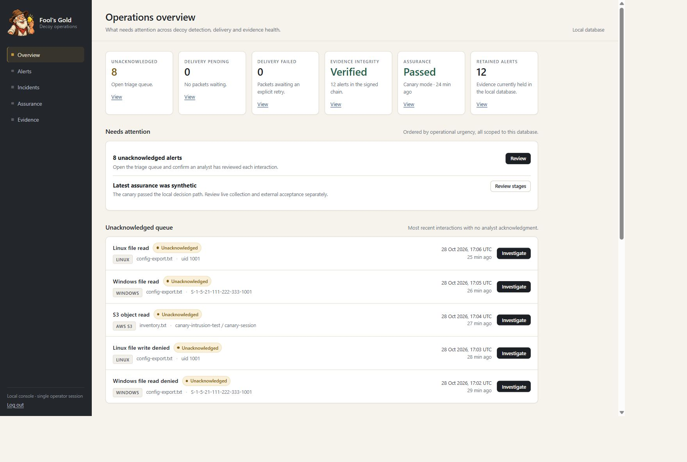
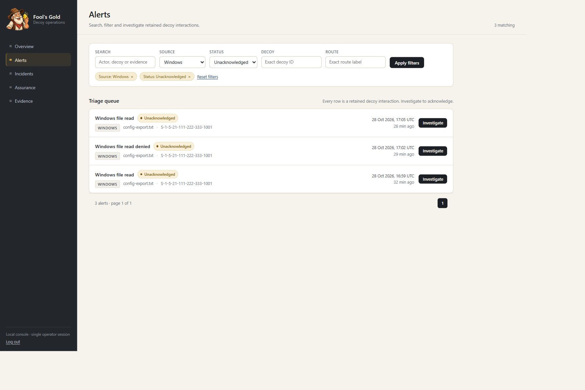
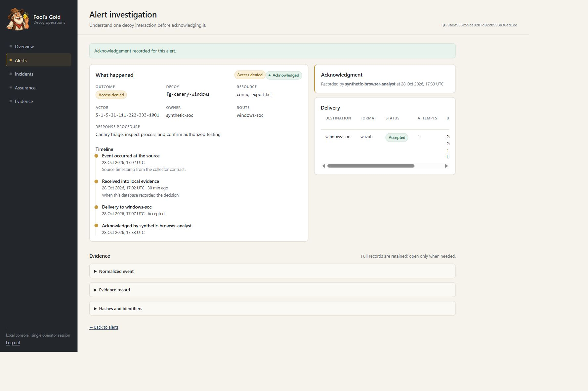
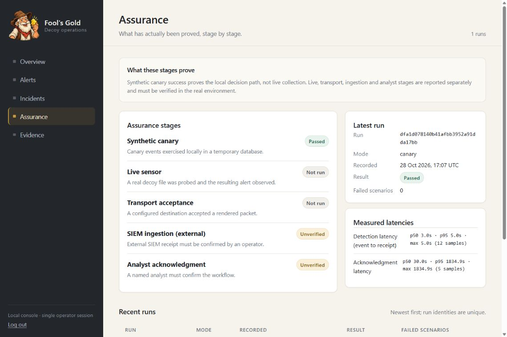
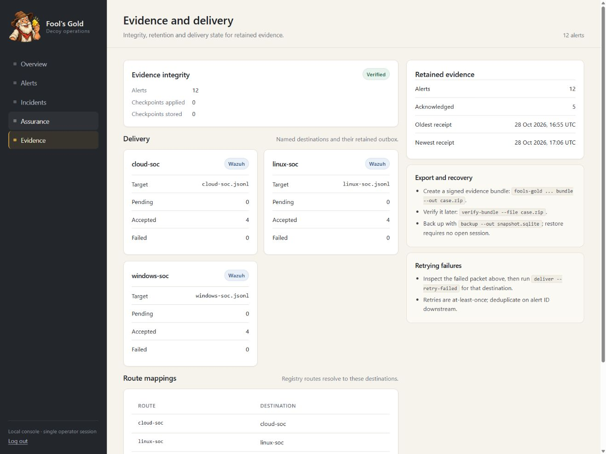

# Fool's Gold


*Looks valuable. Leaves evidence.*

[](https://github.com/fusiontechstrategies/Fools-Gold/actions/workflows/ci.yml)
[](https://github.com/fusiontechstrategies/Fools-Gold/actions/workflows/security.yml)

Put harmless bait where an intruder might look. Know when someone touches it. Regularly prove that the resulting alert can reach a person.

Fool's Gold is an open-source toolkit from Fusion Technology Strategies for internal cyber decoys and detection assurance in AWS GovCloud and Windows environments. Its starting point is CISA's September 16, 2026 paper, **Using Cyber Decoys to Strengthen Detection and Response**.



*Actual local console, using synthetic Windows, S3 and Linux events. Canary success is shown separately from live collection and external acceptance; these are demonstration results.*

## Investigate, acknowledge, and verify

The operations console gives operators six focused views: overview, triage queue, alert investigation, incident groups, assurance stages, and evidence/delivery health. Filter the queue, follow an actor's activity, inspect the event-to-delivery timeline, and record a local acknowledgment without losing the original evidence.

<details>
<summary>Explore the console screenshots</summary>






All screenshots use generated fixtures. Local JSONL delivery acceptance does not prove SIEM indexing or a real analyst workflow.

</details>

## What works today

The first release is an **offline pilot**, with no AWS or SIEM connection required:

- Register exact S3 object locations and Windows file locations with an owner, expiration and response procedure.
- Normalize supported GovCloud CloudTrail S3 data events and a documented Windows Security 4663 collector contract.
- Detect unexpected reads, writes, appends and deletes without relying on a filename prefix.
- Recognize explicitly scoped, expiring authorized access. Keep a decision record instead of silently discarding it.
- Retain individual alert evidence, link nearby activity, and deduplicate exact replay across restarts.
- Record a local analyst acknowledgment and its elapsed time.
- Collect Windows Security 4663 and denied 4656 events live through a fixed `wevtutil` query, filtered to registered decoy locations.
- Accept a documented Linux audit sensor contract for POSIX file access.
- Detect S3 reads, writes, deletes, version reads, copies, `HeadObject` and bucket listings (recon) — including denied attempts — and match listings against registered bucket prefixes.
- Process CloudTrail log files, including gzip, from a watched local inbox, idempotently by content digest.
- Deliver retained alerts durably to Splunk HEC over verified TLS or append Wazuh JSONL locally, with bounded retries, a persistent outbox and optional route filtering, only when the operator configures it.
- Chain alert evidence with HMAC-SHA256 under an operator-held 32-byte key and re-verify the chain later.
- Tag alerts with coarse ATT&CK techniques and cluster them into per-actor incidents.
- Write tamper-evident evidence bundles (entry hashes plus HMAC manifest signature) and verify them later.
- Record assurance runs, publish MTTD/MTTA percentiles, and fail a cron gate when the last successful run is too old.
- Bootstrap and operate: `init`, `plant`, `demo`, `doctor`, `serve` (loopback dashboard with metrics), `prune`, `backup`, `restore`.
- Run a self-contained canary exercise (`check`) that can exercise configured delivery end to end.
- Convert bounded Windows Event XML and CloudTrail Records exports, and render Wazuh JSONL or Splunk HEC packets offline.

**No production deployment, real SIEM ingestion, or analyst workflow has been verified.** Live collection is read-only local tooling; delivery is implemented but untested against a real Wazuh/Splunk installation. Demo timing and analyst actions are simulated, not customer results.

### What is verified locally, and what is not

Verified by the test suite and synthetic exercise: strict parsing and bounds, exact-registry matching, replay/dedup identity, scoped exceptions, HMAC evidence chaining and signed retention checkpoints, bundle hashing/signature states, outbox state machines and failure booking, cursor paging/rollover handling, dashboard authentication/CSRF, recovery procedures, and those CLI flows.

Not verified without real infrastructure: CloudTrail selector behavior and live collection, real Windows SACL/audit policy plus the local `wevtutil` query, real Linux auditd mapping, Wazuh/Splunk parsing, indexing and analyst workflow, TLS trust against a real endpoint, and any GovCloud deployment.

Known gaps, deliberately documented: S3 `DeleteObjects` batches, SMB share events (5145), access-point/Object Lambda ARN variants, copies *from* a decoy to another location, versioned-read ARNs that embed a version id, and SMB/junction/short-name path aliasing. Live assurance reads only registered decoy files for this hostname; Windows actor correlation falls back to new-alert matching because the local SID is not exposed. Integrity is local: deleting every alert, or holding both the database and the HMAC key, is not detectable without external anchoring. Delivery is at-least-once, not exactly-once. Writers serialize per transaction (dashboard, ingestion and delivery can run side by side), while restore requires that no Fool's Gold session has the database open. The dashboard is loopback-only and requires the operator to supply the token at login; it is not a multi-user identity system.

## Install

Python 3.12 or newer. No third-party runtime dependencies.

```powershell
python -m pip install .
fools-gold --help
```

A wheel and source distribution are built by `python -m build`; CI installs the built wheel into a clean virtual environment and runs `fools-gold --help`, `check` and `demo`.

## Try it in sixty seconds

```powershell
python -m fools_gold demo --out runtime/demo
$env:FG_UI_TOKEN = python -c "import secrets; print(secrets.token_urlsafe(32))"
$env:FG_UI_TOKEN # Copy this local token into the login form.
python -m fools_gold --registry runtime/demo/registry.json --database runtime/demo/evidence.sqlite serve --port 8080
```

`demo` writes a synthetic registry, evidence database and a standalone HTML report. `serve` binds only `127.0.0.1` and requires a 16+ character token from `FG_UI_TOKEN` (or `--token-file`). Browsing to the dashboard redirects to a login form; the token is exchanged for a short-lived HttpOnly, SameSite=Strict session cookie (never placed in a URL or persistent storage) and form actions carry a CSRF token. Scripts can keep using `Authorization: Bearer <token>` against `/api/*`, `/metrics` and `/healthz`.

The dashboard shows summary cards, alert filters (search, source, decoy, route, acknowledgment), stable pagination, alert details with event/receipt/delivery/acknowledgment times, incidents, delivery state and the evidence view. `/api/assurance` and `/api/integrity` report assurance history and chain state.

For the richer screenshot walkthrough, run this from a source checkout. Use a new or empty output directory:

```powershell
$env:PYTHONPATH = 'src'
python -m scripts.prepare_showcase --out runtime/showcase
$env:FG_UI_TOKEN = python -c "import secrets; print(secrets.token_urlsafe(32))"
$env:FG_UI_TOKEN # Local login only; never put this in a URL or screenshot.
python -m fools_gold --profile runtime/showcase/profile.json serve --port 8080
```

Open `http://127.0.0.1:8080`. The walkthrough generates 12 synthetic alerts, four simulated acknowledgments, three local JSONL delivery destinations, a signed evidence bundle, and a backup. It performs no AWS requests, SIEM connection, task registration, or audit-policy changes. Its generated keys and runtime files belong in protected local storage; do not publish them.

For a real registry, `init` writes a validated starter document:

```powershell
python -m fools_gold init --out runtime/live --owner soc-team --windows-host fs01 --windows-path 'C:\Decoys\config-export.txt' --write-key
python -m fools_gold plant --type config-export --out 'C:\Decoys\config-export.txt'
python -m fools_gold --registry runtime/live/registry.json --database runtime/live/evidence.sqlite --evidence-key-file runtime/live/evidence.key doctor --max-assurance-hours 24
```

## Try the synthetic pilot

From the repository directory, in PowerShell:

```powershell
$env:PYTHONPATH = 'src'
python -m pip install --require-hashes -r requirements-dev.txt
python -m unittest discover -s tests -v
python -m scripts.run_synthetic_pilot
```

On Linux:

```sh
python -m pip install --require-hashes -r requirements-dev.txt
PYTHONPATH=src python -m unittest discover -s tests -v
PYTHONPATH=src python -m scripts.run_synthetic_pilot
```

The exercise uses an isolated temporary database, a fixed synthetic clock, two synthetic read events, an authorized backup read and a replay. It prints an assurance report and removes its temporary runtime data. The same exercise is available as a command:

```powershell
python -m fools_gold check
```

`check` uses its own canary registry and a temporary database. Add `--wazuh-output` or `--splunk-host`/`--splunk-port` (plus `FG_SPLUNK_HEC_TOKEN` in the environment) to exercise configured delivery as well.

On a Windows host with the file SACL configured, emit registered-decoy events as contract JSONL and ingest them:

```powershell
python -m fools_gold --registry examples/registry.synthetic.json collect-windows --log-epoch <collector-generation-id> > runtime/windows-events.jsonl
python -m fools_gold --registry examples/registry.synthetic.json --database runtime/pilot.sqlite ingest runtime/windows-events.jsonl
```

The query is fixed to event 4663 and only registered locations are emitted; `--follow --interval-seconds N` repeats it until interrupted, and non-contract events are counted on stderr.

For persisted synthetic evidence:

```powershell
New-Item -ItemType Directory -Path runtime
python -m fools_gold --registry examples/registry.synthetic.json --database runtime/pilot.sqlite ingest examples/events.synthetic.jsonl
python -m fools_gold --registry examples/registry.synthetic.json --database runtime/pilot.sqlite report
```

Use the printed `alert_id` to acknowledge an alert:

```powershell
python -m fools_gold --registry examples/registry.synthetic.json --database runtime/pilot.sqlite acknowledge fg-REPLACE_WITH_PRINTED_ID --analyst synthetic-analyst
```

CLI receipt and acknowledgment timestamps use the actual clock. The standalone exercise uses a fixed clock so its expected results remain repeatable. Fixtures dated October 2, 2026 must not be ingested before their event time.

## What the evidence means

Unexpected decoy access is a reason to investigate. It does not prove that the actor is malicious. Antivirus, backup jobs and authorized testing can touch decoys too. Exceptions identify the exact actor and actions, carry a reason and owner, and expire. A denied S3 attempt still alerts, including when the actor has a successful-read exception.

Decoy expiration does **not** switch off detection. It raises a maintenance flag while preserving alerts. SHA-256 values help compare evidence; they do not authenticate its source or protect against an administrator rewriting the database.

## Read next

- [Operator acceptance walkthrough](docs/OPERATIONS.md) — install → init → plant → collect → ingest → verify → deliver → assure → investigate → acknowledge → export → recover
- [Architecture and trust boundaries](docs/ARCHITECTURE.md)
- [Registry, event and alert contracts](docs/CONTRACTS.md)
- [Pilot deployment and acceptance plan](docs/PILOT.md)
- [Threat model and operational limits](docs/SECURITY.md)
- [Synthetic verification results](docs/VERIFICATION.md)
- [Offline collection and delivery adapters](docs/ADAPTERS.md)
- [Deployment review packet](docs/DEPLOYMENT-REVIEW.md)
- [Focused security review](docs/SECURITY-REVIEW-2026-10-02.md)

Placement details, operational telemetry, client information and credentials belong in protected deployment storage. Only synthetic examples belong in this repository. Public source code is not a substitute for access control on your own deployment data.

## Contributing and support

- Report defects and propose changes through [CONTRIBUTING.md](CONTRIBUTING.md).
- Report suspected security issues privately as described in [SECURITY.md](SECURITY.md).

## License

Copyright 2026 Fusion Technology Strategies. Released under the [Apache License 2.0](LICENSE).
