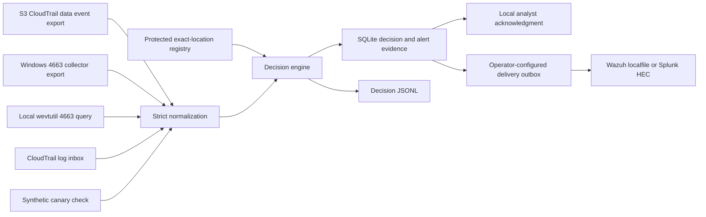

# Architecture

## First complete path

The registry, decision engine and evidence store run locally. The wevtutil query and trail inbox read only operator-local sources; delivery runs only when the operator explicitly configures an endpoint. No command fetches from AWS, and Suricata can later supply surrounding network context — it is not the source of truth for an S3 read or local Windows file read.

Offline Windows XML/CloudTrail export conversion, Wazuh/Splunk payload rendering, live local collection and durable delivery now sit around this path. Real TLS trust, SIEM ingestion and analyst workflow acceptance remain deployment tasks. Retained alerts can be exported again after a failed output operation without changing delivery or acknowledgment state.

## Trust boundaries

1. **Decoy workload:** synthetic content only. No live passwords, keys, customer records or external callback links.
2. **Telemetry collectors:** trusted collectors obtain real CloudTrail or Security events; the local wevtutil query and the trail inbox read only operator-managed sources. Input fields alone do not prove provenance. Production needs controlled collection, authenticated transport and source retention.
3. **Registry:** exact placements and exceptions are security configuration. Protect them from monitored workloads. The CLI consumes a local, operator-selected registry; events cannot choose its filename.
4. **Decision engine:** bounded JSONL, supported contracts and parameterized SQLite statements. No event field is executed, opened as a file or used in a network request.
5. **Evidence:** local SQLite retains decisions and normalized alert details, optionally HMAC-chained under an external key. Production needs protected ACLs, encryption, retention and independent integrity controls.
6. **Delivery:** runs only on explicit operator command with operator-selected endpoints; TLS verification is not bypassable and tokens come only from the environment. Endpoint arguments appear in command history — protect it.
7. **Analyst:** acknowledgment is an explicit local operator action, not containment, case closure or proof that an analyst saw a SIEM alert.

## Correlation and lifecycle

Each supported interaction produces its own durable decision. Nearby alerts for the same decoy and exact actor are linked within a five-minute receipt window. Correlation never collapses or discards evidence.

Source event identity is deduplicated across restarts. A repeated identity with changed raw evidence is rejected. Windows identity combines host, collector-provided log epoch and record ID. An event-log reset must use a new epoch. S3 identity is the CloudTrail event ID scoped by source.

An expired decoy continues to alert with `registry_expired=true`. Exceptions require event time and receipt time to be inside their approved window. Registry edits do not reclassify stored decisions. Review a policy-change replay in a separate database.

## Reuse assessment

Guardian Atlas and JEPA Self-Learning SOC are possible future evidence consumers. IDS Rule Converter can support future network context. No source code from those projects has been copied, and no integration is claimed. Integration evaluation must include interfaces, licenses, dependencies and operational assumptions.

## Guidance alignment

The supplied CISA paper emphasizes internal assets, accountable planning, exposure, threat emulation and feedback. The pilot applies those ideas through exact placement, synthetic tests and recorded decisions. Broader Engage affect/elicit operations, public honeypots and adversary interaction are outside this pilot.

Primary implementation references:

- [AWS S3 CloudTrail logging](https://docs.aws.amazon.com/AmazonS3/latest/userguide/cloudtrail-logging-s3-info.html): explicitly enable data events for chosen resources.
- [AWS S3 request identification](https://docs.aws.amazon.com/AmazonS3/latest/userguide/cloudtrail-request-identification.html): object operations and identities.
- [Microsoft event 4663](https://learn.microsoft.com/en-us/previous-versions/windows/it-pro/windows-10/security/threat-protection/auditing/event-4663): provider, object fields and access-mask semantics.
